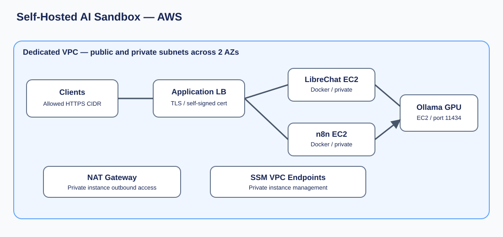

# 01 — Self-Hosted AI Sandbox

Deploy a self-hosted AI environment in a dedicated AWS VPC using **one CloudFormation template**.



## Architecture

The template creates a VPC with two public and two private subnets, an internet gateway, a NAT gateway, SSM interface endpoints, an application load balancer, a private GPU EC2 instance for Ollama, and separate private application EC2 instances for LibreChat and n8n. LibreChat and n8n connect to Ollama over port 11434 using security-group rules.

## Prerequisites

- An AWS account with CloudFormation, EC2, IAM, VPC, ELB, ACM, Lambda, and SSM permissions.
- EC2 GPU capacity and quota for `g4dn.xlarge` in the chosen region.
- A compatible **region-specific NVIDIA Deep Learning AMI ID**, supplied at deployment.
- A client CIDR range for HTTPS access.
- Review all parameters, IAM policies, and expected AWS charges before deploying.

## Deploy

1. Open [template.yaml](template.yaml) and select **Raw** to download it.
2. In AWS CloudFormation, choose **Create stack → With new resources → Upload a template file**.
3. Upload `template.yaml`, enter parameters, review permissions and costs, and create the stack.
4. Use the stack **Outputs** for application URLs and instance IDs.

CLI alternative:

```bash
aws cloudformation deploy \
  --region us-east-2 \
  --stack-name self-hosted-ai-sandbox \
  --template-file template.yaml \
  --capabilities CAPABILITY_IAM \
  --parameter-overrides \
    AllowedClientCidr=203.0.113.10/32 \
    DeepLearningAmiId=ami-REPLACE_WITH_VALID_REGION_AMI
```

The sample CIDR and AMI are placeholders. The template also requires appropriate parameter values for your deployment.

## Access and security

The ALB can be internal or internet-facing, controlled by `AlbScheme`. Restrict `AllowedClientCidr` appropriately. The ALB certificate is **self-signed**, so browsers will warn until you use a trusted certificate. The n8n endpoint is exposed through a separate HTTPS listener; inspect its port in the template and the stack outputs. Do not expose an unauthenticated instance to the internet.

## Costs

This stack incurs charges for the GPU and application EC2 instances, EBS, ALB, NAT gateway, interface endpoints, and data transfer. GPU and NAT charges can be substantial even when idle. Check the [AWS Pricing Calculator](https://calculator.aws/) before deployment.

## Operations and cleanup

- Use AWS Systems Manager Session Manager to access private instances.
- Inspect `/var/log/ollama-bootstrap.log` and `/var/log/librechat-bootstrap.log` for bootstrap errors.
- Check Docker container logs for application failures.
- Delete the CloudFormation stack to remove managed infrastructure; review retained EBS volumes and other persistent resources separately.

## Status

**Deployment testing required.** This is based on the supplied n8n-enabled template and has not been verified by a fresh AWS stack deployment. Pin and test software versions before production use.

## Support

Cloud Optimization Solutions offers architecture, security, integration, and training services. Add your business contact and Marketplace links here.
